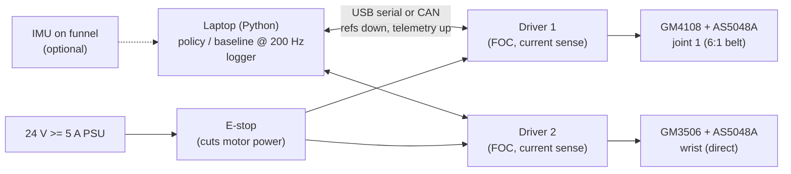

# Embedded & Engineering Handbook

This is the onboarding guide for the embedded / hardware side of **proprio-yoyo**. Read it first. It also holds
the project's **progress log**, so update §1 with every commit.

**Project summary.** A 2-joint arm on a stand throws a yo-yo, keeps it bouncing 3 times, and catches it again.
The robot senses only its own motors: joint angles and motor currents, with no camera in the loop. We design and
test everything in a Python simulator first, then build the hardware. The simulator already runs the whole
task, so the hardware has to behave the way the simulator assumes, or the simulator has to be corrected to match
the hardware. Keeping the two in agreement is the main engineering job (see §4).

**Hand variant:** we build the **flip hand** (`catch_mode = "flip"`). The wrist axis passes through the centre
of the seated yo-yo and there is no magnet. After a catch, the wrist turns 180° so the funnel mouth faces up and
gravity holds the yo-yo. The magnet hand still exists in the code as the default, for comparison.

---

## 1. Progress (update with every commit)

### 1.1 Status by stage

| Stage | What | Status | Owner |
|---|---|---|---|
| 1 Simulation v1 | numpy simulator, funnel, arm, motors, sensors, env, animation | **done** | Yanhao |
| 1+ Flip hand in sim | IN_CUP model, flip controller, full throw → bounce → catch → flip-stow flow, tests | **done** | Yanhao |
| 2 Design freeze | sweeps, pick motors/ratios/arm lengths/funnel, design sheet | **next** | Yanhao (sim) |
| 3 Hardware | print, assemble, motor firmware, comms, safety | **not started**, can start now in parallel (§5, E0–E6) | Arthur |
| 4 SysID + step-by-step on hardware | measure real parameters; throw → bounce → catch | not started | both |
| 5 Learning (if needed) | residual PPO / distillation trained in sim | not started | Yanhao |
| 6 Experiments & wrap-up | ablations, video, open source | not started | both |

### 1.2 Embedded work packages

Tick these as they are finished, and put the commit hash next to each one. Details are in §5.

- [ ] E0 Bench kit: one motor + driver spinning open loop
- [ ] E1 FOC closed loop (position) with the AS5048A
- [ ] E2 Current sensing + current loop; Kt calibrated for both motors
- [ ] E3 Cogging map recorded and subtracted
- [ ] E4 Two-motor host link at 200 Hz; end-to-end latency measured
- [ ] E5 Safety: soft limits, current limits, 50 ms watchdog, hardware e-stop
- [ ] E6 1 kHz logger that writes the simulator's field names
- [ ] E7 Mechanics assembled (stand, joint 1 + belt, link 1, flip wrist with trunnions)
- [ ] E8 Wrist flip test: 180° in t_flip with the yo-yo seated
- [ ] E9 SysID support: step responses, LED sync, impact detection from current
- [ ] E10 Seat-arrival detection from current, < 50 ms

### 1.3 Progress log (newest first)

Add one row per commit that changes anything meaningful, from either of us.

| Date | Commit | Who | What changed | Next |
|---|---|---|---|---|
| 2026-11-15 | (this commit) | Yanhao | Merged PR #1 into main; progress log updated | Stage-2 sweeps; teammate: E0 |
| 2026-11-15 | 78ec9af | Yanhao | Added this handbook, README link, PR template | Teammate: order the bench kit (E0), read §4 |
| 2026-11-14 | e81b4e2 (PR #1) | Yanhao | Flip hand full flow: turn-down throw → 3 bounces → catch → flip stow (`control/full_flow.py`), `scripts/golden.py` refactor guard, 86 tests | Stage-2 sweeps |
| 2026-11-14 | a361940 | Yanhao | Flip catch in the simulator: `IN_CUP` mode, amendment A9 (flip direction must follow the string winding sign σ), `control/stow_flip.py`, 80 tests pass, magnet hand bit-identical | Wire the full flip flow |
| 2026-11-14 | 90335da | Yanhao | Runs gallery page (`python -m scripts.gallery --open`), conda env note | |
| 2026-11-14 | 2ab04b5 | Yanhao | Stage-1 simulator, env, visualization, pulse baseline (throw → 3 bounces → catch, 12/12 nominal) | |
| 2026-11-13 | 69d91e2 | Yanhao | Initial commit | |

---

## 2. Overall plan

Six stages, and each one ends with a gate: if the gate is not met, go back and fix things before moving on. The
full roadmap, with the reasoning behind it, is a separate document (ask Yanhao for the link). The parts that
concern you:

1. **Simulation** (done). Every hardware number lives in [`config/params.yaml`](../config/params.yaml).
   Many are placeholders marked `TODO(sysid)`, waiting for your measurements.
2. **Design freeze** (next, mostly simulation). This fixes motor sizes, gear ratio, arm lengths and funnel
   shape. Until then, build the **bench kit** and the firmware. Don't print final parts yet.
3. **Hardware**, mostly yours. Gate:
   - both joints track a 2 Hz sine with error < 2°;
   - the torque estimated from current is within 15% for a known hanging weight;
   - end-to-end latency is measured and < 20 ms;
   - e-stop and watchdog are tested;
   - the 1 kHz log can be saved, read back and plotted.
4. **SysID + bring-up**, shared. Fit simulator parameters to logs, then throw (≥ 95%), bounce 3 times (≥ 80%) and
   catch (≥ 70%), 30 trials each.
5. **Learning**, only for the step the hand-written controller can't pass. Policies are trained in simulation
   only, then run on a laptop at 200 Hz.
6. **Experiments**: comparison experiments, a demo video, and open-source release (firmware, CAD and BOM included).

---

## 3. System overview (flip hand)

### 3.1 Mechanics

```
   2020 extrusion stand (inverted L, ~1.25 m)
        │
   joint 1 axis ── 8 mm steel shaft in two 608 bearings, 120T pulley
        │  GT2 belt 6:1 ── 20T pulley on the GM4108 (joint-1 motor, on the stand)
        │
   link 1 (carbon tube, l1 = 0.15 m)
        │
   U-fork at the end of link 1
     ├── one side: GM3506 (wrist motor, direct drive) ── trunnion ┐
     └── other side: 608 bearing + stub shaft ───────── trunnion ┘ funnel hangs between them
                                                                   wrist axis = centre of the seated yo-yo
   string exit H: 31 mm on the other side of the wrist axis (l2 = -0.031 m)
```

- Bottom impacts go into the two trunnion bearings, not into the wrist motor's small internal bearing.
- The flip funnel has no magnet: total depth ~88 mm, straight seat ~61 mm, and a trumpet mouth.
  - The inner wall must be smooth (friction μ ≈ 0.1): with μ = 0.3, a yo-yo arriving with a 6° swing stalls
    before it reaches the seat.
  - Soft material (TPU) goes only at the seat bottom.
  - Dimensions are frozen in stage 2. Treat these as current best values.
- A fishing swivel sits at the string exit to release the twist in the string.

### 3.2 Electronics



One driver per motor. The wrist motor is rated for 2–3S (about 12 V), so its driver must cap the phase voltage
at 12 V while running on the 24 V bus (`V_lim2` in the config).

### 3.3 Who runs what

| Layer | Runs on | Rate | Owner |
|---|---|---|---|
| FOC + current loop | driver MCU | 10–20 kHz (current loop time constant ~0.8 ms) | you |
| Joint PD (position mode) | driver MCU | ≥ 1 kHz | you |
| Safety: limits, watchdog | driver MCU | every loop | you |
| Command stream + telemetry | MCU ↔ laptop | 200 Hz commands, 1 kHz telemetry | you |
| Baseline controller / policy | laptop | 200 Hz | Yanhao |
| Logger (sim field names) | laptop | 1 kHz | you, with Yanhao |

---

## 4. The sim ↔ hardware contract (the important part)

The simulator models the firmware and sensors explicitly
([`arm/motor.py`](../arm/motor.py), [`arm/sensors.py`](../arm/sensors.py)). A policy trained in simulation only
works on the robot if every row below is true on the hardware too. When the hardware disagrees, **don't silently
change the firmware to "something better"**. Either make the firmware match the row, or update `params.yaml`
(or the model) in the same commit and note it in the progress log.

### 4.1 Command interface (what the laptop sends)

- **Position mode**: at 200 Hz the laptop sends joint references `(q1_ref, q2_ref)`.
  - `q1` = joint-1 angle (motor angle / 6).
  - `q2` = wrist angle **relative to link 1** (the GM3506's own encoder angle).
- **Firmware law** (`pd_current_command`). The PD has no velocity reference:
  ```
  i1 = (Kp1 (q1_ref - q1) - Kd1 q1_dot) / (Kt1 * N1 * eta1)     # joint-side gains
  i2 = (Kp2 (q2_ref - q2) - Kd2 q2_dot) / Kt2
  ```
  Current gains are `Kp1 = 20`, `Kd1 = 0.5` N·m/rad and N·m·s/rad at the joint; `Kp2 = 1.0`, `Kd2 = 0.015`.
- **Known weakness, your first design improvement.** With a 200 Hz staircase reference and no velocity
  reference, the wrist current shows a 5 ms sawtooth of about ±1 A during the flip. A better interface is
  `(q_ref, qd_ref, tau_ff)` per joint, interpolated linearly between packets on the MCU. If you implement it, tell
  Yanhao so the simulator gets the same law (`arm/motor.py`) before anything is trained on it.

### 4.2 Numbers the firmware must meet or measure

| Quantity | Sim value now | Config key | You |
|---|---|---|---|
| Command latency laptop → driver | 5 ms (randomized 0–15 ms) | `cmd_delay` | measure (E4), gate < 20 ms |
| Encoder | 14 bit (AS5048A), 1 ms delay | `enc_counts`, `enc_delay` | confirm |
| Velocity estimate | differentiated angle, 1st-order low-pass at 100 Hz | `vel_cutoff` | match it, or report your filter |
| Current sense | 30 mA noise, ±20 mA bias, 0.5 ms delay | `i_noise`, `i_bias_max`, `i_delay` | measure (E2) |
| Torque constants | 0.09 / 0.05 N·m/A (placeholders) | `Kt1`, `Kt2` | **measure** with a known weight (E2) |
| Continuous torque | 0.15 / 0.08 N·m | `tau_max1`, `tau_max2` | from datasheets |
| Current limit | `i_peak_ratio` × continuous (flip needs 2× on the wrist for ~0.1 s) | `i_peak_ratio` | set in firmware, report |
| Wrist voltage cap | 12 V on a 24 V bus | `V_lim2`, `V_bus` | set in firmware |
| Friction, cogging | placeholders | `b1 b2 tc1 tc2`, `cogging_amp` | measure (E3, E9) |
| Belt | rigid for now | — | stiffness from a tap test (stage 4) |

### 4.3 Telemetry and logs

- The laptop logger must write the **same field names** as the simulator's log ([`sim/log.py`](../sim/log.py),
  `FIELDS`). Then a real run and a sim run can be overlaid with the same plotting code
  ([`viz/animate.py`](../viz/animate.py)).
- The fields the hardware can produce: `t, q1, q2, q1d, q2d, q1_ref, q2_ref, i1, i2, i1_meas, i2_meas, q1_meas, q2_meas`.
- Every telemetry sample carries the **MCU timestamp**. The laptop receive time alone is not enough, because the
  latency is exactly what we are trying to measure.
- Policy observations are built from these same signals (`OBS_NAMES` in [`sim/env.py`](../sim/env.py)):
  `q1, q2, q1d, q2d, i1, i2, q1_ref, q2_ref` and the previous action.

### 4.4 Flip-hand specific requirements

- **Wrist flip:** 180° in `t_flip` = 0.12 s with a raised-cosine velocity profile. That needs ~0.10 N·m on the
  wrist, above the 0.08 N·m continuous rating, so allow 2× current for ~0.1 s (E8).
- **Flip direction:** set by the controller from the string winding sign σ. One direction keeps the yo-yo in;
  the other drops it. The firmware must accept both directions symmetrically, with no software limit that blocks
  one side.
- **Arrival detection:** when the yo-yo hits the seat, the wrist current shows a clear spike, because the
  yo-yo's spin stops and kicks the wrist. With the mouth facing down, the yo-yo starts sliding out right away, so
  detection → flip start must be **< 50 ms** including the command latency (E10).

---

## 5. Work packages (what to do, in order)

Each package lists a deliverable and an acceptance check. Put firmware in a new top-level `firmware/` folder and
host-side Python (serial protocol, logger) in `host/`. Commit both to this repo.

| # | Package | Deliverable | Done when |
|---|---|---|---|
| E0 | Bench kit | 1 motor + 1 driver with current sensing + encoder + PSU on the bench | open-loop velocity example spins; pole pairs confirmed |
| E1 | FOC closed loop | encoder aligned, position control | holds and tracks steps without oscillating |
| E2 | Current loop + Kt | tuned current loop; Kt from a lever + known weight | torque from current within 15% of the weight torque |
| E3 | Cogging map | current vs angle at slow speed, stored and subtracted | residual ripple plotted before/after |
| E4 | Host link | packet format doc (`host/PROTOCOL.md`), 200 Hz refs down, 1 kHz telemetry up, both motors | latency histogram; write the median into `cmd_delay` |
| E5 | Safety | soft joint limits (joint 1 ±180° hard stop as well), current limits, 50 ms command watchdog → motors off, hardware e-stop on motor power | each one triggered on purpose and seen to stop |
| E6 | Logger | `host/logger.py` writing `log.npz` with sim field names + MCU timestamps | `viz` plots a real log with no code changes |
| E7 | Mechanics | stand, joint 1 + belt (slotted motor mount for belt tension), link 1, U-fork, flip funnel on trunnions | 2 Hz sine tracking < 2° on both joints (stage-3 gate) |
| E8 | Wrist flip | 180° flip test, empty funnel and with a seated yo-yo, t_flip = 0.12 s | flip finishes in t_flip, end error < 5°, peak current logged |
| E9 | SysID support | step responses, LED flash for video sync, current-spike impact detector (threshold + hysteresis) | impact time vs 240 fps video < 5 ms |
| E10 | Arrival detection | seat-arrival detector from wrist current | detection-to-flip-start < 50 ms on 30 hand-fed catches |

You can start E0–E6 now on the bench kit. E7 waits for the stage-2 design freeze (arm lengths, ratio, funnel).

---

## 6. Hardware (flip hand)

Prices are rough estimates for budgeting only. Check before ordering.

| Item | Qty | Spec / notes | Rough USD |
|---|---|---|---|
| Gimbal motor, joint 1 | 1 | GM4108 (or similar), hollow shaft ok | 40–60 |
| Gimbal motor, wrist | 1 | GM3506, 2–3S rated (driver caps it at 12 V) | 25–40 |
| Magnetic encoder | 2 | AS5048A board + diametric magnet (some GM motors ship with one) | 10–15 each |
| FOC driver with **current sensing** | 2 | STM32G431 + DRV8316 class board, or SimpleFOC Mini **v2** + ESP32. Mini v1 has no current sensing: don't buy it | 15–40 each |
| Power supply | 1 | 24 V, ≥ 5 A switching PSU | 20–30 |
| E-stop | 1 | latching mushroom button that cuts motor power (not a GPIO) | 10 |
| Belt + pulleys | 1 set | GT2 6 mm belt; 20T aluminium pulley (motor) + 120T pulley (printed or bought) = 6:1 | 15–25 |
| Bearings | 4+ | 608 (two for joint 1, one for the wrist trunnion, spares) | 1 each |
| Shafts | — | 8 mm steel shaft (joint 1), short stub shaft (wrist) | 5–10 |
| Stand | — | 2020 aluminium extrusion, inverted L ~1.25 m tall, corner brackets, clamp or weight for the base | 30–50 |
| Link 1 | 1 | carbon tube OD 10–12 mm (or thin aluminium square tube), ~0.15 m | 10 |
| Printed parts | — | PETG, 4 walls, ≥ 40% infill: motor mounts (slotted holes), U-fork, flip funnel with trunnions | filament |
| Funnel liner | — | TPU at the seat bottom only | filament |
| Swivel | 2 | small fishing swivel at the string exit | 3 |
| Yo-yo | 2 | Duncan Imperial (fixed steel axle, string tied, ~52 g) | 5–8 each |
| IMU (optional) | 1 | MPU6050 or ICM-42688 on the funnel, 1 kHz | 5–15 |
| Wiring | — | XT60 connectors, silicone wire, JST/Dupont, flexible wire loop across joint 1 | 15 |
| Test gear | — | known weights (kitchen scale), phone with 240 fps + tripod, bright dot sticker, ruler, one LED wired to a driver GPIO | — |
| Tools (if you don't have them) | — | soldering iron, multimeter; a logic analyzer (~$15) helps a lot for E4 latency | — |

**Order now:** one bench kit (one motor, one driver with current sensing, encoder, PSU). It is cheap and you can
afford to burn it. Order the rest after the stage-2 design freeze.

---

## 7. Skills you will use

| Skill | Used for | Where to learn |
|---|---|---|
| FOC motor control (SimpleFOC or the vendor stack) | E0–E3 | SimpleFOC docs and community forum |
| MCU firmware (STM32 / ESP32, PlatformIO or Arduino) | everything on the driver | PlatformIO docs |
| Control basics: PD, current loop, filtering, latency | E1, E2, E4 | any intro controls course; `arm/motor.py` shows the exact model we assume |
| Serial / CAN protocol design, timestamps, ring buffers | E4, E6 | — |
| Python + numpy (reading, not physics) | host tools, logger, overlaying logs with sim | the repo itself; run the demos |
| Safety engineering (watchdog, current limits, e-stop) | E5 | — |
| CAD (Onshape / Fusion 360) + 3D printing | E7, funnel | Onshape tutorials |
| Measurement: scope / logic analyzer, video timing | E4, E9 | — |
| Git: branches, small commits, clear messages | always | §8 |

You don't need the yo-yo physics. `PHYSICS_SPEC.md` is there if you're curious, but your work is defined by §4
and §5.

---

## 8. Workflow

- **Setup:** `conda activate yoyo`, then `pip install -r requirements.txt`. Run `pytest -q`; everything must
  pass. Look at the simulator with `python -m scripts.run_demo flip_stow` and
  `python -m scripts.gallery --open`.
- **Branches:** work on your own branch (e.g. `hw/e2-current-loop`) and merge into `main` through a pull request
  or after a quick review.
- **Every commit that changes behaviour:**
  1. Update §1 of this file: tick the package and add a row to the progress log.
  2. If you measured something, replace the value in `config/params.yaml`, remove its `TODO(sysid)`, and leave a
     comment with how and when it was measured (e.g. `# measured 2026-12-03, lever 10 cm, 3 weights`).
  3. Don't edit simulator physics (`yoyo/`, `sim/simulator.py`) without telling Yanhao: the tests and trained
     policies depend on it.
- **Language:** code, comments, docs and commit messages in English.
- **Raw logs** go under `runs/` (git-ignored). Commit only small summary plots or tables.

## 9. Open questions (decide together)

- Serial (USB) or CAN between the laptop and two drivers? CAN is cleaner with two boards; USB serial is faster to
  start.
- One MCU driving both motors, or one per motor? The current plan is one per motor, which is simpler to debug.
- Extend the firmware interface to `(q_ref, qd_ref, tau_ff)` (§4.1)? Recommended, but the simulator must change
  in the same step.
- IMU on the funnel: worth the extra cable across two joints?
